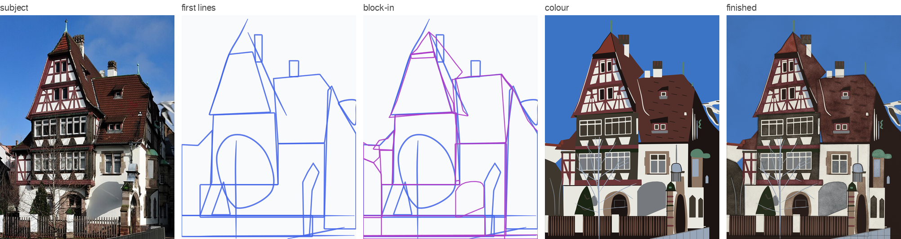
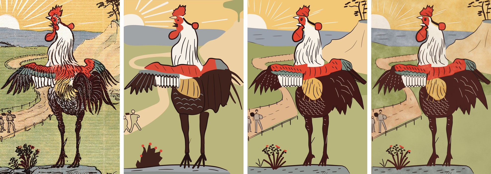
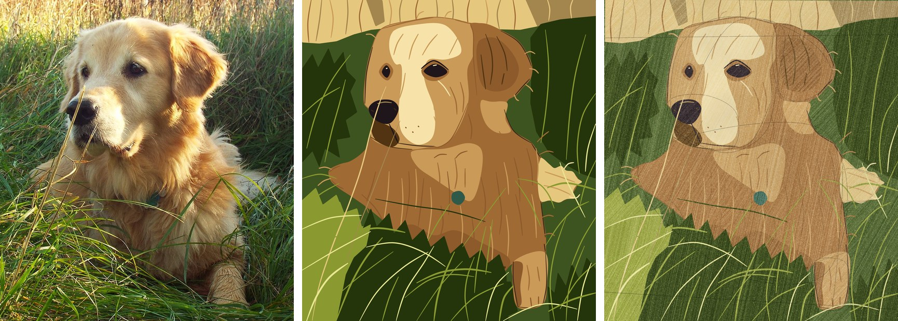
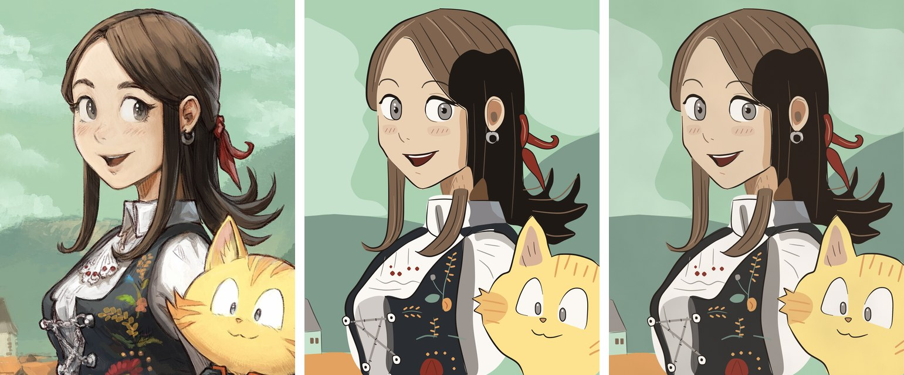
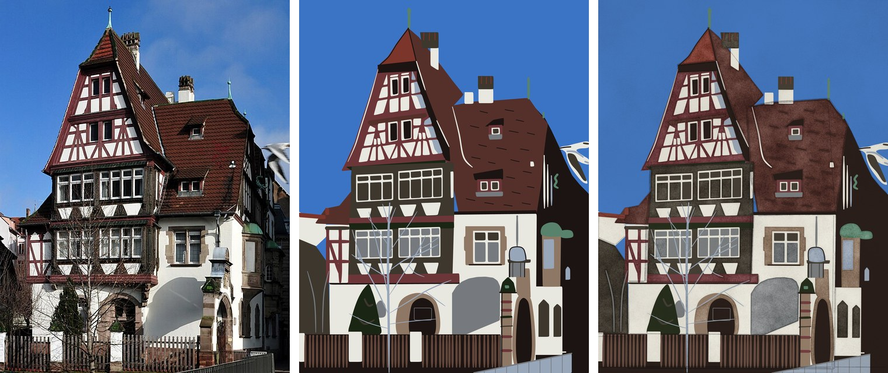
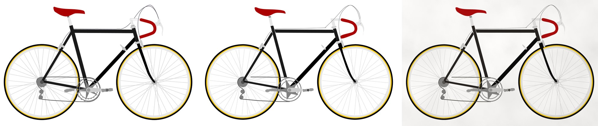
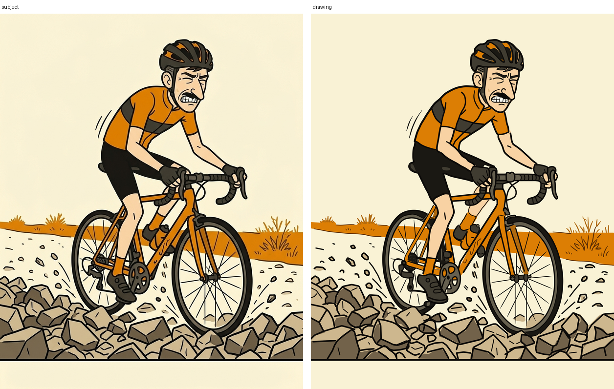
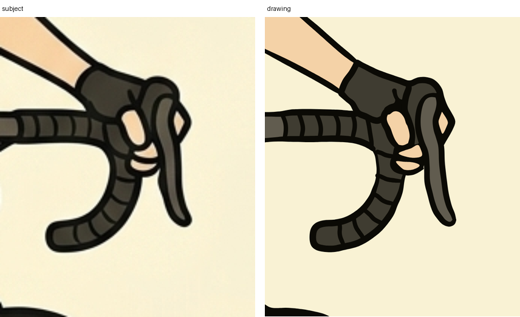
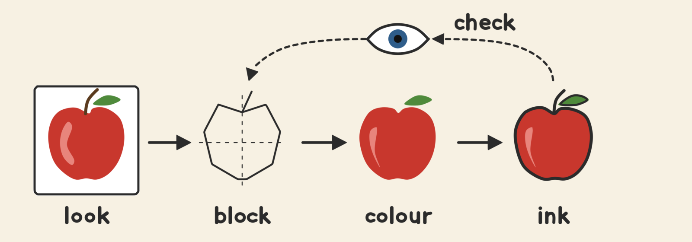

# drawing

**A Claude Code skill that makes Claude draw the way a person does: one mark at
a time, from a subject in front of it.**



No image model is involved. Claude writes every stroke itself, as numbers in a
Python script, and a real canvas ([tldraw](https://tldraw.com)) renders it. It
works the way a drawing class teaches you to: loose lines for the pose first,
then straight lines to get the proportions right, then shapes of flat colour,
then the real outline, ink and shading. After every step it compares its render
with the subject before going on.

The result is a drawing you can open and edit, stroke by stroke, not a
generated image.

## Install

As a Claude Code plugin:

```
/plugin marketplace add jchapuis/drawing-skill
/plugin install drawing@drawing-skill
```

Or clone it into your skills folder:

```bash
git clone https://github.com/jchapuis/drawing-skill ~/.claude/skills/drawing
```

Then set up the canvas once:

```bash
cd ~/.claude/skills/drawing/harness && npm install && npm run build && npx playwright install chromium
```

You also need Python with `numpy`, `scipy`, `pillow` and `opencv-python`, and
the `claude` CLI on your PATH.

## Use

Put the picture you want drawn in an empty folder as `subject.png`, and ask:

> Draw subject.png by hand.

You can ask for a medium and a paper too ("as watercolour and ink on cold-press
paper", "as a pencil sketch with the construction lines left in"). Claude sets
up the folder, works through the stages, and leaves you `drawing.png`, a
styled `final.png` if you asked for one, and the tldraw document behind them.

## Gallery



A rooster from a hand-coloured print. From left to right: the subject; an early
drawing, with the shapes right but no hatching and one even outline; the
current one, after the skill learned to measure hatching and line weight; and
that drawing finished as watercolour and ink. *Subject: Randolph Caldecott,
public domain.*



From a photograph: the subject, the drawing, and a coloured-pencil finish with
the construction lines left faint. *Subject: David Whelan, CC0.*



A portrait from a painted illustration, finished in brush pen. The cat coming
into the frame is drawn too, not dropped. *Subject: "Pepper and Carrot in
traditional clothing of Bergen" by David Revoy (peppercarrot.com),
[CC BY 4.0](https://creativecommons.org/licenses/by/4.0/); cropped and redrawn.*



A building from a photograph, finished as a watercolour sketch. The timber
pattern and the number of windows are counted and checked. *Subject: photo by
Ralf Roletschek (Strasbourg, 2014),
[CC BY 3.0](https://creativecommons.org/licenses/by/3.0/); cropped and redrawn.*



A flat vector bicycle with no outline, finished in ink pen on smooth paper.
*Subject: "Flat design Race Bicycle", Openclipart, CC0.*



A whole scene, drawn by several agents at once (one each for the head, body,
handlebars, bicycle, wheels and rocks), then put together and finished by one
more.



One part, a hand on a brake lever, checked magnified four times. Small parts are
always judged up close, never at the size of the whole picture.

## How it works



The diagram above was drawn by the skill, mark by mark, in a test run where
the agent had only the skill and [this flat source](docs/how-it-works-subject.png).
Even the words are lettered by hand.

### Claude draws; the tools only measure

The tools can tell Claude where things are in the subject: where an edge runs,
how wide a line is, how many spokes a wheel has. They never produce a stroke.
Claude reads the measurement and types the points itself.

This is enforced. The pen refuses to save a drawing whose strokes come from a
loop, a shape function or another file, or whose points are mostly not typed
out as numbers. Auto-tracing the subject into strokes is forbidden outright,
because a traced copy can pass every check and still not be a drawing.

### Stages, each checked before the next

| Stage | What Claude draws | How it is checked |
|---|---|---|
| Read | nothing yet: it samples the colours, lists the parts, and notes what the picture shows | a separate agent describes the subject, and its answers become the target |
| Gesture | a few loose lines for the pose and the big shapes | the same agent, shown only these lines, has to read the same action |
| Block-in | straight lines on the subject's edges | the block-in is overlaid on the subject |
| Construction | how each volume turns in space | written down for every main form |
| Masses | flat colour shapes, back to front | at thumbnail size, the two must read as the same picture |
| Contour and ink | the real outline, then ink lines at measured widths, then hatching | checks for edges drawn twice, lines that stop short, wrong overlap order, and hatching at the wrong angle or weight |
| Correct | small fixes aimed by the judges | the describer's account of the drawing has to match the subject's |

A scene adds a planning layer on top: one centre of interest, a few big masses
of light and dark, and a table of what overlaps what. Each object is then drawn
through the stages above, in place.

### Blind judging

The main judge is a separate Claude run that sees only the drawing, never the
subject or the script. It answers five fixed questions: what is this, what is
each figure doing, what touches what. If it says "a beetle" where the subject
shows a helmet, the drawing is wrong, whatever the numbers say. Parts are cut
out and described one by one, so a hand that reads as a paw gets caught.

Every complaint, from a judge or from Claude's own eye, is measured on both
images before any mark moves. About a quarter of a critic's complaints turn out
to be wrong.

### Styles

A `style.json` next to the drawing picks the medium (ink pen, brush pen,
pencil, marker, watercolour and ink, gouache), how loose the hand is, the paper,
and whether to add a scanned look. The style changes how the marks are rendered,
never which marks there are. See [reference/style.md](reference/style.md).

## Cost

This trades speed for fidelity. One object carried through every stage uses
roughly 350–450k tokens. A full scene split across about eight agents uses
roughly 3M.

## Extending it

- **A new kind of subject.** Add `reference/<subject>.md` and list it in
  `SKILL.md`'s Reference section. Give it a ` ```checklist ` block naming the
  object and its pieces (`object: bike|bicycle` /
  `sub-forms: tyre|tire rim spoke hub ...`). The build then refuses a parts
  list (`parts.json`) that leaves one of those pieces out without a reason.
- **A new check.** Add a function and a flag in `check.py`, with a test in
  `test_tools.py` that passes a known-good case and fails a known-bad one.
- **A new instrument.** Add a `tool` to `INSTRUMENTS` in `pen.py`.
- **The describer's questions** are the `PROMPT` in `describe.sh`.
- **The canvas** is a tldraw document in `harness/`, driven headless by
  Playwright. You can open the same document in tldraw afterwards and edit it by
  hand.

## What's in the repo

```
SKILL.md          the stages, the rules, and a map of the references
reference/        the detail: the first stage, marks, judging, style,
                  the full method, scenes, and one file per kind of
                  subject (head, figure, bird, bicycle, building, ...)
                  and per craft topic (line, colour, tone, light, ...)
pen.py            stroke(), frame(), write(): the pen, and the check
                  that refuses generated marks
trace.py          measures flat or printed art into regions
segment.py        measures photographs and paintings into regions
crop.py, look.py  crop, magnify, probe and read coordinates
check.py          the checks
describe.sh       the blind describer
finish.py         renders the styled final picture
brush.py          an optional brush renderer for the final picture
build.sh          renders every stage of a drawing
gates.sh          runs every check that applies, one line each
harness/          the tldraw canvas, driven from the command line
test_*.py         every check tested on known-good and known-bad cases
docs/             the images in this README
```

## Licence

MIT, see [LICENSE](LICENSE).
